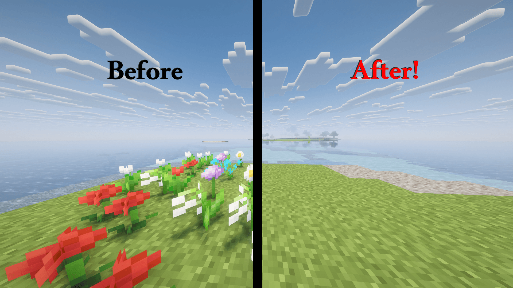

This mod removes flower generation in Minecraft.

Requires Fabric API.

[Play this with my other mod (Remove Grass) that removes grass.](https://github.com/LiterallyUs/removegrass/releases/tag/1.0.0)

Bone meal still works.

This mod removes the generation of the following flowers: dandelion, poppy, blue orchid, allium, azure bluet, red tulip, orange tulip, white tulip, pink tulip, oxeye daisy, cornflower, lily of the valley, sunflower, lilac, rose bush, peony, pink petals, wildflowers, closed eyeblossom, open eyeblossom, wither rose, torchflower, pitcher plant, golden dandelion.
